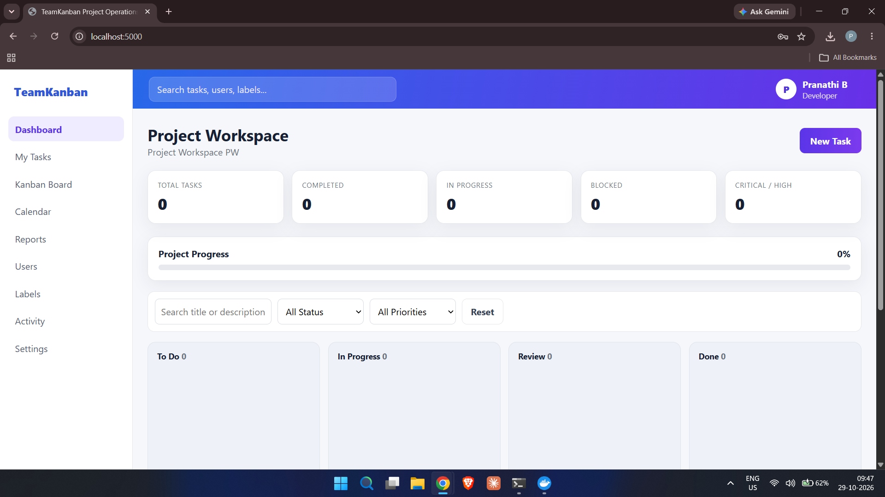
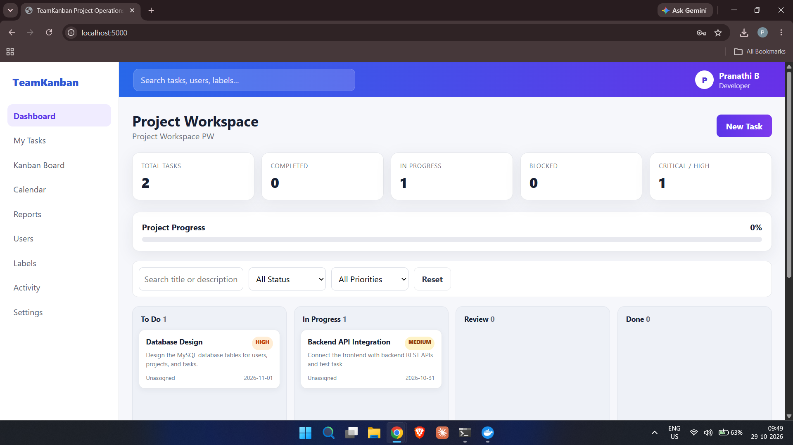
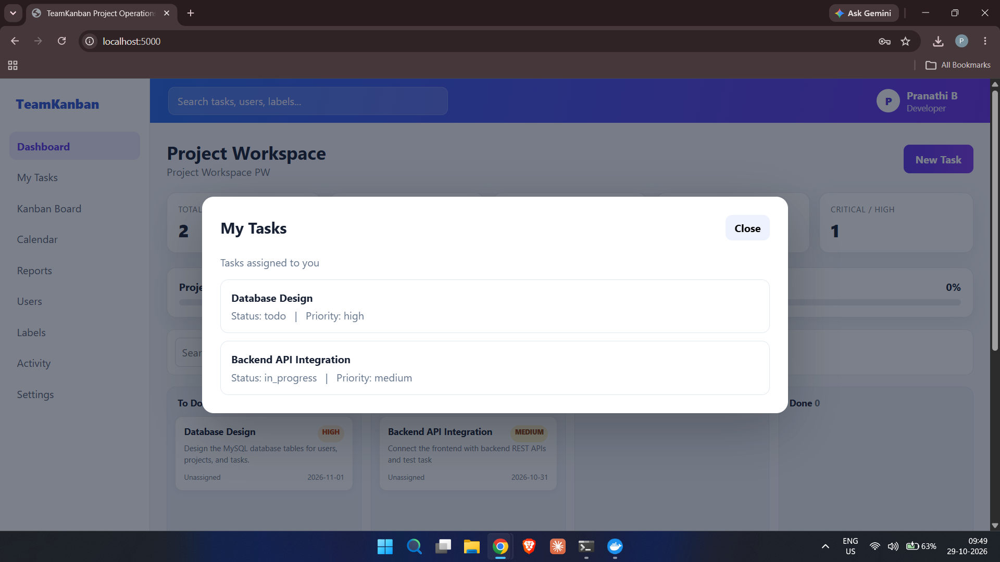
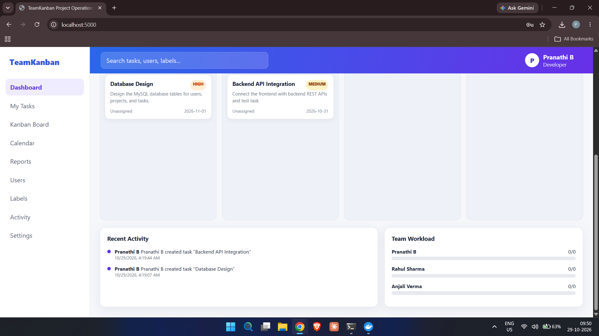

# TeamKanban — Team Workflow & Project Management Platform

TeamKanban is a web-based project and task management application designed to help teams organize tasks, monitor progress, and manage workflows through a centralized workspace.

## Application Screenshots

### Dashboard


### My Tasks


### Kanban Board


### Recent Activity


## Key Features

- Centralized dashboard for task tracking
- Create and manage project tasks
- Kanban workflow: To Do, In Progress, Review, and Done
- Task priorities, descriptions, and due dates
- Task search and filtering
- User and project management interfaces
- Recent activity tracking
- Dashboard metrics and progress indicators
- MySQL database integration
- REST API-based backend
- Responsive web interface

## Technology Stack

| Component | Technologies |
|---|---|
| Frontend | HTML5, CSS3, JavaScript |
| Backend | Node.js, Express.js |
| Database | MySQL 8 |
| API | REST APIs |
| Additional integration | PHP APIs, Socket.IO |
| Development tools | Git, GitHub, Docker |

## System Architecture

```text
             User
               |
               v
    Frontend (HTML, CSS, JavaScript)
               |
               v
       Node.js + Express.js
               |
               v
            REST APIs
               |
               v
          MySQL Database
```

The frontend provides the user interface. The backend processes application requests and communicates with the MySQL database to store and retrieve project information.

## Local Setup — Windows

### Prerequisites

- Node.js
- Docker Desktop with MySQL, or a compatible MySQL 8 instance
- Git

### 1. Clone the repository

```bash
git clone https://github.com/pranathibopparaju006/Team-Kanban.git
cd Team-Kanban
```

### 2. Install dependencies

```bash
npm install
```

### 3. Configure environment variables

Create a `.env` file using `.env.example` as a reference. Configure the database host, port, database name, username, and password for your local environment.

Never commit `.env` files or real credentials to GitHub.

### 4. Start MySQL

If the `teamkanban-mysql` Docker container has already been created, start it with:

```bash
docker start teamkanban-mysql
```

Otherwise, configure a MySQL 8 instance and ensure the database settings match your `.env` file.

### 5. Start the application

```bash
npm start
```

Open the application in your browser:

**http://localhost:5000**

Keep the terminal and database running while using the application.

## Project Structure

```text
Team-Kanban/
├── backend/
│   └── src/
├── frontend/
│   ├── css/
│   ├── js/
│   ├── index.html
│   └── login.html
├── php/
│   └── api/
├── docs/
├── scripts/
├── screenshots/
│   ├── dashboard.png
│   ├── my-tasks.png
│   ├── kanban-board.png
│   └── recent-activity.png
├── .env.example
├── .gitignore
├── package.json
└── README.md
```

## Learning Outcomes

- Understanding frontend and backend integration
- Working with REST APIs
- Configuring and connecting a MySQL database
- Developing and testing a web application
- Using Git and GitHub for version control
- Troubleshooting local development environments

## Future Enhancements

- Advanced project analytics and reporting
- Improved notifications and collaboration
- Enhanced role-based permissions
- Mobile-friendly improvements
- Cloud deployment

## Author

**B. Sai Krishna Pranathi**

GitHub: [pranathibopparaju006](https://github.com/pranathibopparaju006)

---

*Developed as part of an academic and internship project workflow.*